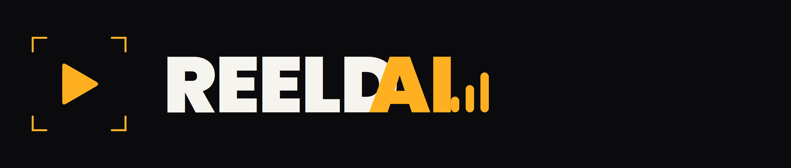

<div align="center">

<a href="https://shahin134053.github.io/Reeldaiii/">
  
</a>

### 🎬 Context-Aware 2D Storytelling Animation Studio in Your Browser
**Turn Voiceover Audio, SRT Subtitles, & Scripts into Synchronized 16:9 YouTube & 9:16 Reels Animated Videos — Free, Open Source & Up to 4K UHD.**

**বাংলা ও ইংরেজি ভয়েসওভার অডিও, SRT সাবটাইটেল এবং গল্পের স্ক্রিপ্ট থেকে সরাসরি ব্রাউজারেই তৈরি করুন ১৬:৯ ইউটিউব ও ৯:১৬ রিলস ২ডি অ্যানিমেশন ভিডিও — কোনো ডাউনলোড বা পেইড সফটওয়্যার ছাড়াই!**

[](https://shahin134053.github.io/Reeldaiii/)
[](https://shahin134053.github.io/Reeldaiii/)
[](https://shahin134053.github.io/Reeldaiii/?page=studio)
[](./LICENSE)

[](https://react.dev/)
[](https://www.typescriptlang.org/)
[](https://shahin134053.github.io/Reeldaiii/)
[](https://shahin134053.github.io/Reeldaiii/?lang=bn)
[](https://github.com/shahin134053/Reeldaiii/stargazers)

---

### 🔗 Instant Clickable Links (কোনো ইনস্টলেশন ছাড়াই সরাসরি চালান)

| Quick Access | Link | Description (English & বাংলা) |
| :--- | :--- | :--- |
| **🌐 Full Live Studio** | **[https://shahin134053.github.io/Reeldaiii/](https://shahin134053.github.io/Reeldaiii/)** | **Open & use the full Reeldaiii software online** / সম্পূর্ণ ওয়েবসাইট সরাসরি ব্যবহার করুন |
| **🎬 Video Creation Studio** | **[Launch Studio Workspace →](https://shahin134053.github.io/Reeldaiii/?page=studio)** | Jump straight into Audio, SRT, Recorder & Script creation |
| **🎙️ In-Browser Voice Studio** | **[Record Voiceover Live →](https://shahin134053.github.io/Reeldaiii/?page=studio&tab=create)** | Record narration directly via your microphone inside Reeldaiii |
| **📖 User Manual (গাইডলাইন)** | **[Read Interactive Guide →](https://shahin134053.github.io/Reeldaiii/?page=manual)** | Complete English & Bengali step-by-step manual |
| **👨‍💻 Developer Profile** | **[About Md Shahin →](https://shahin134053.github.io/Reeldaiii/?page=developer)** | Meet the creator, social links & SupportKori |

</div>

---

## ✨ What is Reeldaiii? (English)

**Reeldaiii** is an **open-source, 100% browser-native 2D storytelling animation studio** built for YouTubers, Reels/Shorts creators, educators, podcasters, and storytellers.

Drop your **voiceover audio (`.mp3`/`.wav`)**, **timed subtitles (`.srt`)**, or a **plain story script**, and Reeldaiii automatically compiles synchronized scenes, parallax worlds, phonetic lip-sync character performances, adaptive camera choreography, ambient weather/music, and exports directly in **16:9 Landscape** and **9:16 Vertical** up to **4K UHD (`3840×2160` / `2160×3840`)**.

---

## 🌟 Reeldaiii কী এবং কেন ব্যবহার করবেন? (বাংলা)

**Reeldaiii** হলো একটি সম্পূর্ণ **ওপেন-সোর্স ২ডি স্টোরিটেলিং অ্যানিমেশন স্টুডিও**, যা কোনো ভারী সফটওয়্যার বা ইনস্টলেশন ছাড়াই সরাসরি আপনার কম্পিউটার বা মোবাইল ব্রাউজারে চলে।

- **ভয়েসওভার + SRT থেকে অটো অ্যানিমেশন:** আপনার গল্পের ভয়েসওভার অডিও এবং `.srt` সাবটাইটেল আপলোড করলেই প্রতিটি ডায়ালগ ও আবেগ অনুযায়ী দৃশ্য, ক্যারেক্টারের ঠোঁট নড়া (Lip-Sync), ক্যামেরা মুভমেন্ট ও ব্যাকগ্রাউন্ড স্বয়ংক্রিয়ভাবে তৈরি হয়।
- **হিউম্যান-টাচ ভয়েসওভার সাপোর্ট:** প্রাণবন্ত ও আবেগপূর্ণ ভয়েসওভার তৈরি করতে **ElevenLabs** ও **Cartesia AI**-এর সরাসরি লিংক পাবেন, অথবা চাইলে স্টুডিওর ভেতরের **বিল্ট-ইন রিয়েল-লাইফ ভয়েস রেকর্ডার** দিয়ে নিজেই কণ্ঠ রেকর্ড করতে পারবেন।
- **১৬:৯ ইউটিউব এবং ৯:১৬ রিলস/শর্টস একসাথে:** একই প্রজেক্ট থেকে ল্যান্ডস্কেপ (YouTube) এবং ভার্টিক্যাল (Facebook Reels, TikTok, YouTube Shorts) দুটি ফরম্যাটেই **720p, 1080p Full HD এবং 4K UHD** ভিডিও রেন্ডার ও ডাউনলোড করা যায়।

---

## 🚀 Core Features & Highlights

- **🎙️ 3 Powerful Creation Workflows**:
  1. **Audio + SRT Upload**: Millisecond-accurate synchronization for `.mp3` / `.wav` voiceovers and `.srt` captions.
  2. **Built-In Real-Life Voice Recorder**: Record directly inside your browser with live teleprompter cues, waveform metering, and instant WAV attachment.
  3. **Script-Only Quick Animation**: Paste any English or Bengali story script to auto-generate timed scenes, captions, and character animation.
- **🎧 Human-Touch AI Voiceover Ecosystem**:
  - Clickable workflow integrations for **[ElevenLabs](https://elevenlabs.io/)** & **[Cartesia AI](https://play.cartesia.ai/)** for lifelike storytelling narration, paired with **Reeldaiii Built-In Studio Recorder**.
- **🎨 Reference Animation Video & Image Matcher**:
  - Upload any reference animation video (`.mp4`/`.webm`/`.mov`) or image (`.png`/`.jpg`/`.webp`) to extract 3 dominant color swatches, match lighting/camera style, or blend as an atmospheric backdrop.
- **📚 Ready-Made Story Templates**:
  - One-click presets for **Fairy Tale (রূপকথা)**, **Horror & Mystery (ভৌতিক ও রহস্য)**, **History & Heritage (ইতিহাস ও ঐতিহ্য)**, **Motivational (মোটিভেশনাল)**, and **Children's Rhymes (ছোটদের ছড়া)**.
- **🧑‍🎨 Custom Character Designer**:
  - Customize protagonist name, role, outfit colors, hairstyle, glasses, hat/tupi, beard, and scarf across every scene.
- **🗣️ 10-Shape Phonetic Viseme Lip-Sync & 32+ 2D Worlds**:
  - Procedural rain, lanterns, moonlight, village roads, classrooms, tea stalls, and expressive eye/mouth choreography.
- **📺 Dual `16:9` & `9:16` Preview & 4K Export**:
  - Hardware-accelerated browser `.mp4` / `.webm` rendering with burned-in English/Bengali subtitles and auto-ducking ambient music.
- **🌐 Bilingual Studio (`English` & `বাংলা`) + Dark/Light Themes**:
  - Switch the full UI, templates, manual, and developer bio seamlessly.

---

## 🛠️ Run Locally or Self-Host (লোকাল ও হোস্টিংজার গাইড)

Because Reeldaiii's animation compiler, voice recorder, and 4K video renderer run **100% client-side**, you can run it locally or deploy the static `dist/` folder to **GitHub Pages**, **Hostinger `public_html`**, **Vercel**, or **Netlify** for free!

```bash
# 1. Clone the open-source repository
git clone https://github.com/shahin134053/Reeldaiii.git
cd Reeldaiii

# 2. Install dependencies
npm install

# 3. Start development server on http://localhost:3000
npm run dev
```

### Production Build & Tests

```bash
npm run lint    # TypeScript type-checking
npm test        # Run all unit tests (node --test via tsx)
npm run build   # Build static production bundle into dist/
```

---

## 👨‍💻 Developer & Creator

<div align="center">


### **Md Shahin (মোঃ শাহীন)**
*Creator & Software Engineer — Dhaka, Bangladesh*

[](https://github.com/shahin134053)
[](https://www.linkedin.com/in/shahin134053/)
[](https://www.facebook.com/Designpro202)
[](mailto:shahin.prpl@gmail.com)
[](https://www.supportkori.com/shahin134053)

**⭐ If Reeldaiii helps your storytelling, please Star this repository & share it with creators!**  
**⭐ রিলেদাই (Reeldaiii) আপনার ভালো লাগলে গিটহাবে স্টার (Star ⭐) দিন এবং সবার সাথে শেয়ার করুন!**

</div>

---

## 📄 License

Open-source under the **[MIT License](./LICENSE)** — Free to use, study, customize, and deploy worldwide.

---

### 🏷️ Topics & Hashtags (English & বাংলা)

`#Reeldaiii` `#2DAnimation` `#StorytellingStudio` `#AIAnimation` `#VoiceoverToVideo` `#SRTToVideo` `#ReelsMaker` `#YouTubeShortsGenerator` `#4KAnimation` `#OpenSourceSoftware` `#WebVideoEditor` `#Canvas2D` `#React19` `#TypeScript` `#LipSync` `#ElevenLabs` `#CartesiaAI` `#ContentCreatorTools` `#AnimationGenerator` `#FreeVideoMaker` `#GitHubPages` `#MadeInBangladesh` `#BanglaTech` `#বাংলা_অ্যানিমেশন` `#২ডি_অ্যানিমেশন` `#গল্পের_ভিডিও` `#ভয়েসওভার_ভিডিও` `#ইউটিউব_শর্টস` `#ফেসবুক_রিলস` `#ওপেন_সোর্স` `#বাংলাদেশী_সফটওয়্যার` `#অ্যানিমেশন_স্টুডিও` `#ফ্রি_ভিডিও_মেকার` `#কনটেন্ট_ক্রিয়েটর`
